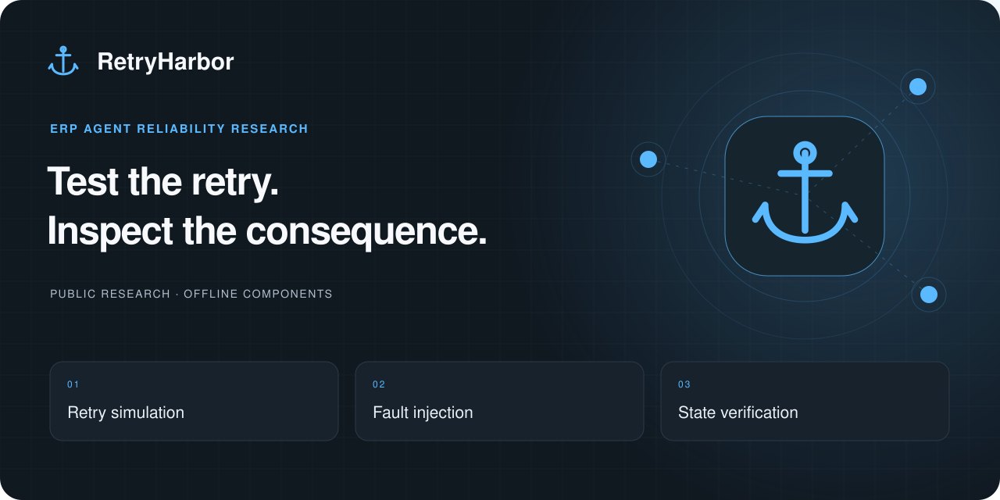
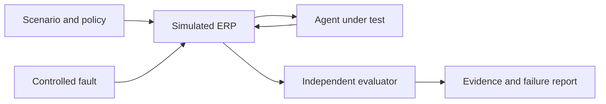

<p align="center"></p>

# RetryHarbor — ERP agent reliability research

<p align="center"></p>

[](https://github.com/vishwanathmuthuraman/erp-agent/actions/workflows/implementation.yml)
[](pyproject.toml)
[](LICENSE)
[](https://github.com/vishwanathmuthuraman/erp-agent/actions/workflows/docs.yml)

[Quick start](#run-the-initial-implementation) · [Implemented scope](docs/IMPLEMENTATION.md) · [Architecture](docs/02-architecture.md) · [Evaluation](docs/04-evaluation.md) · [Contribute](CONTRIBUTING.md)

---

**How does an agent behave when an ERP workflow retries, partially fails or changes its contract?**

Define a simulated purchase-order interface, inject controlled faults, and distinguish successful completion from dangerous or misleading success.

**Stage: initial offline implementation.** Runnable Python components, synthetic demos and behavioral tests are available. The complete workflow, predictive/model evaluation and production product remain pending.

This is the public research project previously called **ERP Agent Testbench**. The repository URL, Python package and CLI commands remain unchanged.

## Run the initial implementation

Install [uv](https://docs.astral.sh/uv/getting-started/installation/), then run these commands from this repository. The runtime is pinned to Python 3.12.13; dependencies are pinned in `uv.lock`.

```sh
uv sync --locked
uv run --locked erp-bench run examples/clean-retry.case.json
uv run --locked pytest
```

The CLI prints JSON. `validate` checks the same input contract; invalid or unsupported input returns exit code 2 with a JSON error on stderr. Successful inspection returns exit code 0. A seeded defect can return exit code 0 while its JSON check verdicts are `fail`: the specimen ran successfully and the checkers caught it.

```sh
uv run --locked erp-bench run examples/duplicate-retry.case.json
```

**Verified locally:** 18 behavioral/CLI tests, Ruff checks, and an installed wheel executed outside the checkout. See [completed tasks and next steps](docs/IMPLEMENTATION.md), [the actual verification record](reports/initial-implementation/verification.json) and [captured demo output](reports/initial-implementation/demo-1.json). This evidence covers the initial offline components; the full study remains pending.

[Explore the example](#a-concrete-example) · [Architecture](docs/02-architecture.md) · [Evaluation protocol](docs/04-evaluation.md) · [Engineering standards](ENGINEERING.md)

## A concrete example

An agent submits an order update. The request times out. Retrying may complete the intended change—or perform it twice.

[Clean retry](examples/clean-retry.case.json) · [Duplicate retry](examples/duplicate-retry.case.json) · [Fixture guide](examples/README.md)

The expected outcomes describe the intended behavior. They are not output from an executed application.

## How the proposed system works



A useful testbench must catch consequential failures without treating every blocked task as a successful test of the agent.

## What you can inspect today

| Artifact | What it establishes |
|---|---|
| Requirements and architecture | The proposed problem, boundaries and consequential design decisions. |
| Original synthetic scenarios and schemas | Concrete inputs and explicit expected behavior. |
| Evaluation protocol and release criteria | How implementation and claims should be assessed. |
| Source rationale | Which public evidence motivated the design and which conclusions remain hypotheses. |
| [Initial implementation](docs/IMPLEMENTATION.md) | Runnable component code, boundary tests and captured synthetic output. |
| Documentation checks | Whether the supplied JSON, relative links and original SVG assets are structurally valid. |

Two original synthetic case specifications with expected outcomes, data contracts, fault taxonomy and an evaluation design.

## Technical choices

Python + SQLite for the simulator, deterministic reference agent and evaluator. The planned CLI and HTML report work locally; live ERP credentials are outside the research scope.

Python, Go, Rust, SQL, TypeScript and Rails each have appropriate uses. This project follows [documented selection rules](ENGINEERING.md): add a runtime or framework only when requirements, profiling and maintainability justify it.

## What the evaluation must show

Cover duplicate execution, policy/approval violations, schema mismatches and partial execution. Separate evaluator evidence from agent-visible data. Compare safe completion, harmful actions, false alarms and unresolved outcomes.

The [evaluation protocol](docs/04-evaluation.md) defines the comparison and limitations. No benchmark score, customer impact, novelty claim or independent endorsement is asserted.

## Read the design

| Start with | Then inspect |
|---|---|
| [Problem and requirements](docs/01-product-requirements.md) | [Architecture and boundaries](docs/02-architecture.md) |
| [Public implementation milestones](docs/03-build-plan.md) | [Evaluation protocol](docs/04-evaluation.md) |
| [Definition of done](docs/05-definition-of-done.md) | [Sources and design rationale](docs/06-sources-and-design-rationale.md) |
| [Technical limitations](docs/07-delivery-and-risk.md) | [Publication boundaries](docs/08-publication.md) |

## Check this documentation

From a clone of this repository with Python 3.12 or later:

```sh
python scripts/check_public_docs.py
```

This checks documentation only. Behavioral tests run separately in the **Implementation checks** workflow. The repository's **Documentation integrity** workflow runs the same check on pushes and pull requests.

## Research roadmap

- [x] Define the problem, contracts and illustrative synthetic scenarios.
- [x] Document evaluation methods and consequential failure cases.
- [x] Implement and test the initial offline components documented above.
- [ ] Complete the full offline workflow and baseline required by the release criteria.
- [ ] Complete held-out comparisons and publish actual results, including failures.
- [ ] Seek independent reproduction and review.

## Scope and contribution

See [contribution guidance](CONTRIBUTING.md) for useful review questions. Reports should include a minimal synthetic example and the relevant requirement or evaluation rule. Never submit customer records, credentials or private operational information.

This is a curated research repository. Internal delivery schedules and commercial planning are maintained separately. Public technical methods are deliberately inspectable; public availability does not imply production readiness.

Maintained by [Vishwanath Muthuraman](https://github.com/vishwanathmuthuraman). Source material is cited; citations do not imply endorsement. Original code, documentation and synthetic fixtures are licensed under Apache-2.0; see LICENSE and NOTICE. Third-party material retains its own terms.

## License

Original repository material is licensed under [Apache-2.0](LICENSE). See [licensing and attribution](docs/09-licensing.md) for scope, third-party material and distribution requirements.
