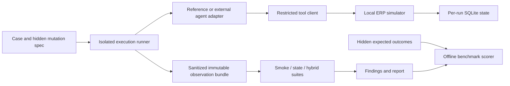

# 02 — Proposed architecture and layout

Status: design contracts, not implemented APIs. [Requirements](01-product-requirements.md).

## Boundaries



The agent sees task, tool schemas and tool results. It cannot read fixture files, databases, expected results or mutation controls. Suites see the same sanitized observation bundle; only the scorer receives ground truth. Reference-agent behavior and the checking code live in separate modules. Checker code must not import mutation or expected-result modules.

An external adapter is a trusted integration supplied by the operator. Version 1 does not promise to contain malicious Python code. Running arbitrary agent code in the runner process would defeat isolation. For supported external adapters, use a separate process with a minimal environment and a restricted RPC/tool channel; no direct database mounts. Network isolation must be verified for the chosen execution environment, not inferred from localhost URLs. Untrusted adapters require a later, independently reviewed sandbox.

Reference-agent mutants are controller-selected specimen variants, not options exposed to the agent. External agents receive disturbances through the tool boundary; do not pretend to mutate their internals unless a separately documented test wrapper supports that operation.

## Proposed implementation tree

Only README, docs, schemas, examples, planning and hygiene files exist now. The following source/test paths are future work:

```text
pyproject.toml                 # Python >=3.12,<3.13; erp-bench entry point
uv.lock                       # generated and committed after dependency selection
src/erp_agent_testbench/
  cli.py                      # validate, execute, check, benchmark, compare, report
  contracts.py                # strict typed boundary records
  runner.py                   # isolation, timeout, manifests, artifact lifecycle
  storage.py                  # SQLite schema, foreign keys, transactions
  simulator.py                # tool methods and operation state machine
  faults.py                   # controller-only disturbance/mutation hooks
  observation.py              # allowlisted export; no oracle fields
  adapters/base.py            # versioned adapter protocol
  adapters/reference.py       # deterministic agent
  adapters/subprocess.py      # independent process/RPC adapter
  suites/smoke.py
  suites/state.py
  suites/hybrid.py
  scoring.py                  # joins predictions with sealed ground truth
  reporting.py                # JSON plus escaped static HTML
  compare.py                  # paired release regressions
  web.py                      # optional localhost read-only FastAPI viewer
tests/{unit,integration,evaluation,acceptance}/
fixtures/development/         # reviewed development cases, after implementation
protocol/                     # public protocol and release manifests
.github/workflows/ci.yml      # proposed; create only after local checks work
```

Shared tooling is optional. Start with local versioned contracts and fixtures; do not import a sibling checkout. Extract a package only when a real package version, lockfile and compatibility tests exist. Every clean install must work without other projects.

## Interfaces

All interfaces below are proposed version `0.1`. Choose one JSON serializer and canonical request-hash definition before implementing hashes.

| Boundary | Input | Output / rule |
| --- | --- | --- |
| `AgentAdapter.run` | public task, restricted tool client, limits | terminal `completed`, `review_required`, `failed` or `incomplete`; summary and operation IDs |
| `read_order` | order ID | quantity, integer unit price, currency, supplier, version |
| `read_policy` | supplier ID | active status, policy version, amount threshold |
| `read_approval` | operation ID | approved quantity delta/price, authority limit, expiry tick, policy version |
| `apply_amendment` | operation/order IDs, quantity delta, unit price, approval ID, idempotency key | operation ID, status, updated order version; validates schema before side effects |
| `get_operation` | operation ID | all matching attempt records and statuses; exposes ambiguity rather than selecting one silently |
| `resume_operation` | server operation-record ID, original idempotency key | finish missing commitment for that record without reapplying the order delta |
| `CheckSuite.evaluate` | immutable observation, rule manifest, checking budget | structured findings, checked/skipped rule IDs, elapsed work, verdict |

RPC requests carry `protocol_version`, `request_id`, `method`, `params`; responses carry the same ID and either `result` or a typed error. Errors distinguish invalid arguments, policy denial, timeout/unknown commit state, unsupported operation and infrastructure failure. Timeouts never imply that the server rolled back.

Local execution does not require an HTTP service. The planned subprocess adapter communicates JSON Lines through pipes; the parent controls simulator access. An optional FastAPI layer exposes read-only report routes (`GET /runs`, `/runs/{id}`, `/runs/{id}/findings`) on `127.0.0.1`. No write route, authentication claim or Internet deployment is included.

## Data and state

Proposed SQLite tables: `orders`, `approvals`, `policies`, `operation_attempts`, `commitments`, `events`. Each database belongs to one run. `operation_attempts` has a unique idempotency key; business operation IDs are indexed but deliberately not unique, so the checker can detect repeated intent submitted under new keys. This provider-like contract must be explicit in every report.

An operation moves `requested → validated → order_applied → committed`. Denial occurs before `order_applied`. For partial-execution tests, an injected interruption may leave `order_applied` without a commitment. Recovery uses the recorded intermediate state. `completed` is legitimate only once the matching commitment exists. Do not claim atomicity across these modeled steps.

Initialize each connection with `sqlite3.connect(..., autocommit=True)`, enable `PRAGMA foreign_keys=ON`, and verify the pragma returns `1` before setting `connection.autocommit = False` for explicit commit/rollback work. SQLite cannot change foreign-key enforcement inside an active transaction; setting the pragma after starting that transaction would silently leave the intended control disabled. Limit version 1 to one writer per database. Concurrent scenarios get separate files; parallel clients within a scenario use a deterministic serialized scheduler. This makes race coverage limited and disclosed.

Request hash covers operation ID, order ID, quantity delta, unit price, currency and approval ID. It excludes transport attempt ID and idempotency key. A changed request with the same key returns a conflict. A matching key returns the original recorded operation/result even after response loss. Approval binding checks the approved business fields and current policy, not just possession of an approval ID.

## Observation and report contracts

An observation contains `schema_version`, opaque `case_token`, `execution_id`, task, initial/final business snapshots, public policy/approval records, ordered events, terminal agent result, execution budget usage and artifact hashes. Export no fault label, mutation name, expected rule list, split label or template group. It may include facts from which a defect can be inferred; hiding valid evidence would make evaluation artificial.

Apply the allowlist recursively to both agent inputs and suite observations. Replace descriptive scenario/run IDs and filenames with opaque tokens; omit controller paths and mutation annotations embedded in auxiliary metadata. Hash only the sanitized artifact in the runtime view. Keep the reversible provenance map in the controller and join it after scoring for the human report. Preserve genuine business fields and observed tool errors. Planned leakage tests plant sentinel labels in nested metadata, filenames and IDs and assert that neither evaluated interface receives them.

Events have `event_id`, sequence, logical tick, actor, tool, request ID, business operation ID, request hash, public arguments/result or typed error, and affected record IDs. Full model reasoning is neither requested nor stored. Preserve external content as data; HTML-escape it in reports.

Findings contain rule ID, severity, evidence IDs, expected condition, observed value, and explanation. Suite verdicts are `pass`, `fail`, `inconclusive`, `error`. Benchmark classification is computed later. A report also records case/protocol/code/adapter versions, limits, measured runtime, optional token/cost usage and unsupported behaviors.

## Viewer layout

Static report first: a header with run identity and **synthetic evaluation** label; status cards for evaluated/failed/inconclusive/error counts; a sortable case table; and a detail panel showing expected condition, observed state, ordered tool evidence and state diff. Regression view has separate “new failures”, “fixed failures” and “unpaired cases” tables. Keyboard navigation, text labels and readable contrast are required; color alone never communicates status. The report remains readable without JavaScript.
